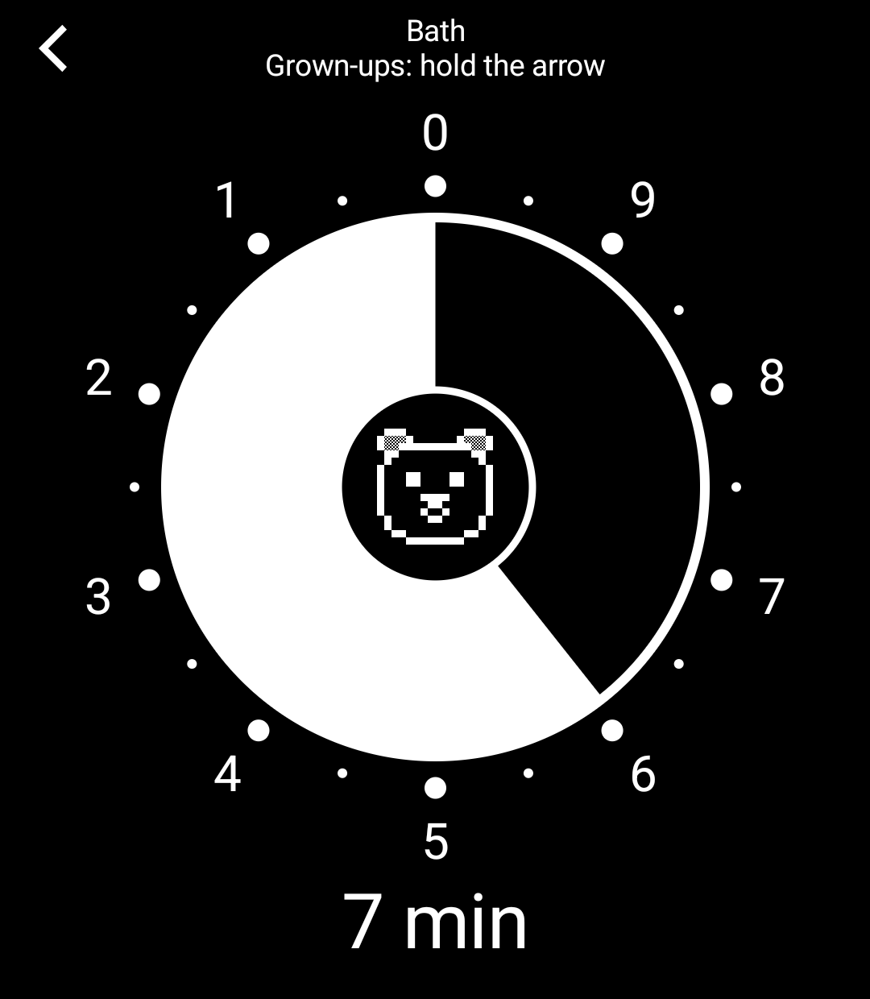
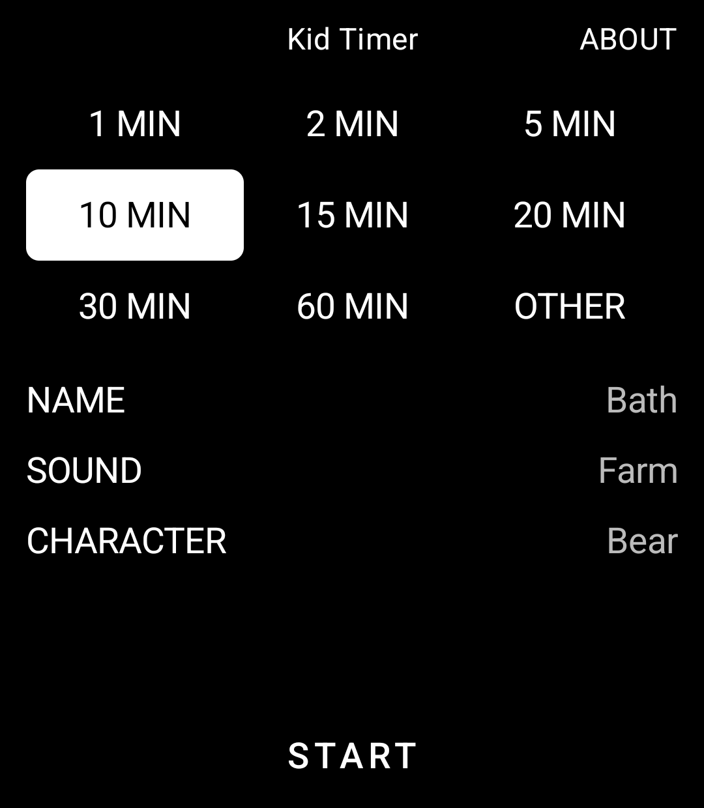
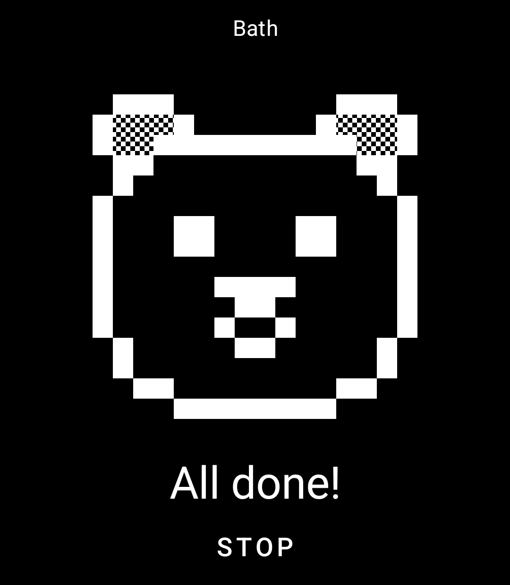

# Kid Timer

A timer a small child can read, for the Light Phone III. Built with the [Light SDK](https://github.com/lightphone/light-sdk) by Slow Pixels.

<p>
  
  
  
</p>

- **Pick the minutes, tap Start.** The screen stays on and shows a disc. The slice shrinks as the time runs out, so a child who can't tell the time can still see how long is left.
- **Twelve 8-bit characters** wait in the middle of the disc. When the time is up the character moves, makes its own sound and plays a tune.
- **Six tunes:** Jungle, Farm, Xylophone, Music box, Cuckoo clock and Toy alarm.
- **Several timers at once,** each with a name if you like, and +30 s on each.

Everything you hear is made on the phone by a small synthesiser in this repo (`sound/`). Nothing is recorded.

## Privacy

Kid Timer works with no connection. It collects nothing, sends nothing and has no ads or tracking. Your timers and choices stay in a small file in the tool's own storage. `lighttool.toml` asks for no permissions; the ones in the built app come from the SDK.

## How it fits LightOS

A tool can't set an alarm, open itself or change the volume, so:

- **While a timer runs,** a background job (`run/Hub.kt`) keeps the tool awake, so it can ring with the screen off or another tool in front. It takes nothing from other sound: a podcast keeps playing until the ring. A job may run for ten minutes, so each one hands over to the next.
- **The ring** comes from the SDK's voice at alarm level, with a buzz. It holds the phone's sound only while it plays, so a podcast pauses for the ring and comes back after. It follows the phone's alarm volume.
- **If the timer isn't on screen,** the tool can't bring it up. You hear the ring and open Kid Timer to stop it, or it stops by itself after five minutes.
- **The kid screen** stays on with `Modifier.keepScreenOn()`. A grown-up leaves it by holding the arrow for three seconds. A back swipe can't be refused, so the tool shows the same picture underneath and puts the kid screen back at once (`ui/HomeScreen.kt`). The Menu button always leaves, and the timer keeps running.
- **The phone's own keys** do nothing on the kid screen, so a child can't turn the end sound down or open the camera. While it rings, any of them stops it.

Timers are kept by when they end, so they survive the tool being closed. One that's found more than ten minutes past its end doesn't ring out of nowhere: it stays listed as ended until you clear it.

## Building

This is a copy of Light's SDK (version 0.2.3, commit 2f02ecd) with the tool in `tool/`, without Light's GitHub workflows. Build it as any Light tool:

```bash
./gradlew :tool:installDebug
```

To run it on the LightOS emulator, see [the emulator guide](docs/system_app/README.md). The tests cover the timers, the disc and the sounds:

```bash
./gradlew :tool:testDebugUnitTest
```

They also leave every tune and call as a WAV in `tool/build/sounds`, to hear on a computer.

## Licence

MIT, as the SDK is. See [LICENSE](LICENSE) for the SDK and [LICENSE-KID-TIMER](LICENSE-KID-TIMER) for the code in `tool/`.
